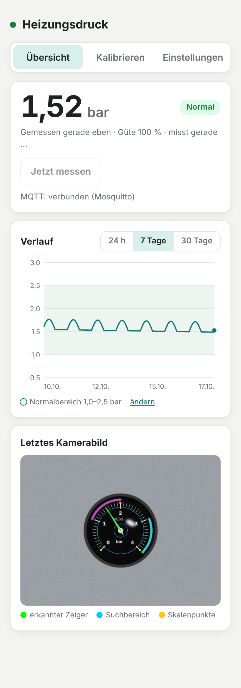
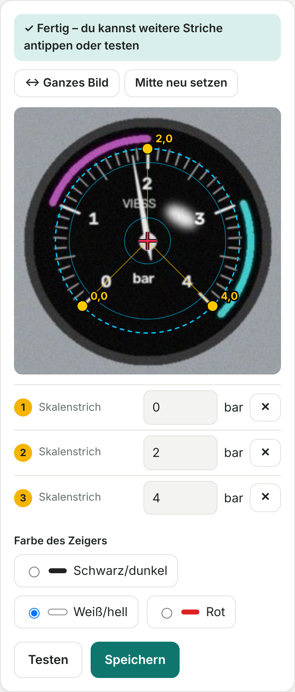

# Manometer-Leser

Liest das **analoge Manometer deiner Heizung** mit einer ESP32-CAM ab und macht daraus einen digitalen Druckwert, mit Verlauf, Alarmen und Anbindung an **Home Assistant**, **ioBroker**, **HomeKit** und alles, was MQTT spricht. Am Manometer und an der Heizung selbst wird nichts verändert.

```
ESP32-CAM ──Foto──▶ Manometer-Leser ──▶ Weboberfläche (Druck, Verlauf, Kalibrierung)
(ESPHome)           (Bilderkennung)  ├──▶ Home Assistant (eigene Integration, über HACS)
                                     └──▶ MQTT ──▶ ioBroker, Node-RED, openHAB …
```

<p>
  
  
  
</p>

*Bilder mit simuliertem Manometer.*

## Funktionen

- **Zeigererkennung** für schwarze, weiße/helle oder rote Zeiger, mit Erkennungsgüte pro Messung
- **Kalibrieren per Antippen** im Browser: Live-Vorschau, Lupe, Vergrößern, Bild drehen, sofort testen
- **Automatisches Nachführen:** Verrutscht die Kamera etwas, findet das Programm das Manometer wieder
- **LED nur während der Messung** an
- **Verlauf** über 24 h, 7 und 30 Tage mit einstellbarem Normalbereich
- **Home-Assistant-Integration** (HACS): Druck, Problem-Sensor „außerhalb Normalbereich“, Kamerabild, Knopf „Jetzt messen“
- **MQTT** mit mehreren Verbindungen, Ziele pro Verbindung wählbar (Home Assistant, ioBroker, Andere)
- **Updates über die Weboberfläche**, Passwortschutz, optimiert fürs Handy

## Was du brauchst

| | |
|---|---|
| Kamera | ESP32-CAM (AI-Thinker, OV2640) mit **ESP32-CAM-MB**-Aufsteckboard zum Flashen |
| Strom | stabiles USB-Netzteil, **mind. 5 V / 1 A** |
| Halterung | hält die Kamera fest 10–20 cm vor dem Manometer |
| Server | Rechner, der dauerhaft läuft: z. B. ein Debian-/Ubuntu-Container auf Proxmox (1 Kern, 512 MB RAM, 4 GB) |
| ESPHome | z. B. als Add-on in Home Assistant oder über [web.esphome.io](https://web.esphome.io) |

## Schnellstart

1. **Kamera einrichten:** ESPHome-Firmware aufspielen → [docs/01-esp32-cam.md](docs/01-esp32-cam.md)
2. **Manometer-Leser installieren:** im Container
   ```bash
   apt update && apt install -y wget unzip
   cd /root && wget -O manometer-leser.zip https://github.com/DEIN-GITHUB-NAME/manometer-leser/archive/refs/heads/main.zip
   unzip -o manometer-leser.zip && bash manometer-leser-main/reader/install.sh
   ```
   Danach im Browser `http://<Container-IP>:8080` öffnen → [docs/02-manometer-leser.md](docs/02-manometer-leser.md)
3. **Kalibrieren:** In der Weboberfläche Foto aufnehmen, Achse und Skalenstriche antippen, testen, speichern.
4. **Anbinden:**
   - Home Assistant → [docs/03-home-assistant.md](docs/03-home-assistant.md)
   - ioBroker → [docs/04-iobroker.md](docs/04-iobroker.md)
   - MQTT allgemein → [docs/05-mqtt.md](docs/05-mqtt.md)

## Aufbau des Repositorys

```
custom_components/manometer_leser/   Home-Assistant-Integration (wird von HACS installiert)
esphome/manometer-cam.yaml           Firmware-Konfiguration für die ESP32-CAM
esphome/secrets.example.yaml         Vorlage für WLAN-Daten und Schlüssel
reader/                              Manometer-Leser (Python, Weboberfläche, install.sh)
docs/                                Anleitungen
```

## Updates

- **Manometer-Leser:** In der Weboberfläche *Einstellungen → Update* die Zip dieses Repositorys hochladen (auf GitHub: *Code → Download ZIP*). Einstellungen, Kalibrierung und Verlauf bleiben erhalten.
- **Home-Assistant-Integration:** über HACS
- **Kamera:** in ESPHome „Install → Wirelessly“

## Hinweis

Die Druckgrenzen in Anleitungen und Voreinstellungen (1,0–2,5 bar) sind Richtwerte. Den richtigen Fülldruck für deine Anlage nennt dir dein Heizungsbauer bzw. die Anleitung der Therme. Dieses Projekt ersetzt keine Wartung und keine Sicherheitseinrichtung der Heizung.
