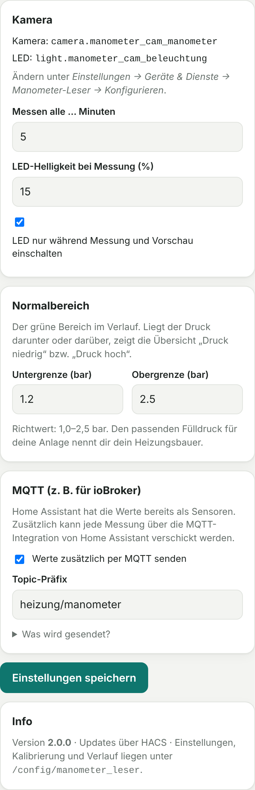

# Manometer-Leser

[](https://hacs.xyz)
[](docs/03-home-assistant.md)
[](docs/01-esp32-cam.md)

Liest das **analoge Manometer deiner Heizung** mit einer ESP32-CAM ab und macht daraus einen digitalen Druckwert in **Home Assistant**, mit Verlauf, Alarmen, HomeKit und auf Wunsch MQTT für ioBroker. Am Manometer und an der Heizung selbst wird nichts verändert.

**Du brauchst nur zwei Dinge:** die ESP32-CAM und Home Assistant. Die Bilderkennung läuft direkt in Home Assistant, ein extra Server ist nicht nötig.

```
ESP32-CAM (ESPHome) ──Bild──▶ Home Assistant: Integration „Manometer-Leser“
                                ├─ Sensoren: Anlagendruck, außerhalb Normalbereich, …
                                ├─ Seitenleiste „Manometer“: Kalibrieren, Verlauf, Einstellungen
                                └─ optional MQTT ──▶ ioBroker, Node-RED …
```

<p>
  
  
  
</p>

*Bilder mit simuliertem Manometer.*

## Installation in 3 Schritten

**1. ESP32-CAM einrichten:** ESPHome-Firmware aufspielen und in Home Assistant hinzufügen → [docs/01-esp32-cam.md](docs/01-esp32-cam.md)

**2. Integration installieren:**

[](https://my.home-assistant.io/redirect/hacs_repository/?owner=dieseltoby124&repository=manometer-cam&category=integration)

Knopf anklicken (oder in HACS: *⋮ → Benutzerdefinierte Repositories* → `https://github.com/dieseltoby124/manometer-cam`, Typ **Integration**) → **Herunterladen** → Home Assistant **neu starten**.

**3. Einrichten und kalibrieren:**
*Einstellungen → Geräte & Dienste → Integration hinzufügen → „Manometer-Leser“* → Kamera und LED der ESP32-CAM auswählen. Dann in der Seitenleiste **„Manometer“** ein Foto aufnehmen, Achse und Skalenstriche antippen, testen, speichern. Fertig.

Details, Automationen und HomeKit: [docs/03-home-assistant.md](docs/03-home-assistant.md)

## Funktionen

- **Zeigererkennung** für schwarze, weiße/helle oder rote Zeiger, mit Erkennungsgüte pro Messung
- **Kalibrieren per Antippen** in der Seitenleiste: Live-Vorschau, Lupe, Vergrößern, Bild drehen, sofort testen
- **Automatisches Nachführen:** Verrutscht die Kamera etwas, findet die Erkennung das Manometer wieder
- **LED nur während der Messung** an, gesteuert über Home Assistant
- **Entitäten:** Anlagendruck, Problem-Sensor „Druck außerhalb Normalbereich“, Kamerabild mit erkanntem Zeiger, Knopf „Jetzt messen“, Diagnosewerte
- **Verlauf** über 24 h, 7 und 30 Tage mit einstellbarem Normalbereich
- **Vermerke** wie „Wasser nachgefüllt“ mit Druck vorher/nachher, als Markierung im Verlauf
- **HomeKit** mit einem Haken: Druck als „Temperatur“, Alarme als Wassermelder mit kritischer Mitteilung
- **MQTT** (optional, über die MQTT-Integration von Home Assistant) für ioBroker & Co.
- Updates über HACS

## Was du brauchst

| | |
|---|---|
| Kamera | ESP32-CAM (AI-Thinker, OV2640) mit **ESP32-CAM-MB**-Aufsteckboard zum Flashen |
| Strom | stabiles USB-Netzteil, **mind. 5 V / 1 A** |
| Halterung | hält die Kamera fest 10–20 cm vor dem Manometer |
| Home Assistant | ab 2025.1, mit HACS; ESPHome z. B. als Add-on oder über [web.esphome.io](https://web.esphome.io) |

## Aufbau des Repositorys

```
custom_components/manometer_leser/   Home-Assistant-Integration (wird von HACS installiert)
esphome/manometer-cam.yaml           Firmware-Konfiguration für die ESP32-CAM
esphome/secrets.example.yaml         Vorlage für WLAN-Daten und Schlüssel
reader/                              Optional: eigenständiger Server für Nutzung ohne Home Assistant
docs/                                Anleitungen
```

## Weitere Anleitungen

- [ESP32-CAM einrichten](docs/01-esp32-cam.md)
- [Home Assistant: Integration, Automationen, HomeKit](docs/03-home-assistant.md)
- [ioBroker](docs/04-iobroker.md) · [MQTT](docs/05-mqtt.md)
- [Ohne Home Assistant: eigenständiger Server](docs/02-ohne-home-assistant.md)

## Hinweis

Die Druckgrenzen in Anleitungen und Voreinstellungen (1,0–2,5 bar) sind Richtwerte. Den richtigen Fülldruck für deine Anlage nennt dir dein Heizungsbauer bzw. die Anleitung der Therme. Dieses Projekt ersetzt keine Wartung und keine Sicherheitseinrichtung der Heizung.
