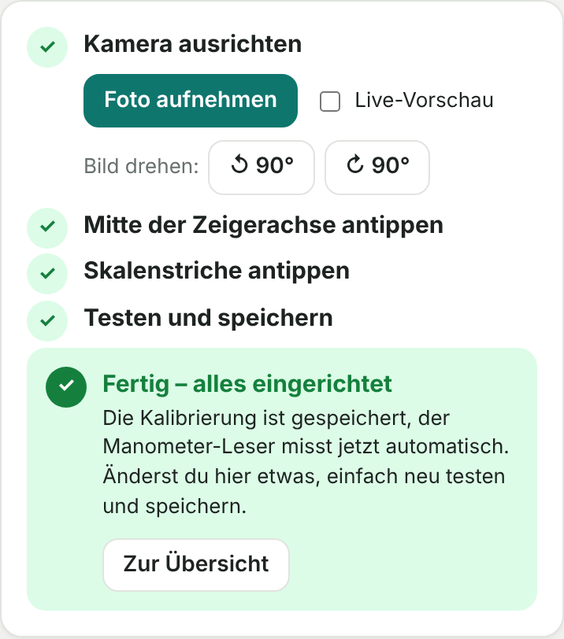

# 2. Ohne Home Assistant: eigenständiger Server

> **Mit Home Assistant brauchst du das nicht.** Dort erledigt die Integration alles → [03-home-assistant.md](03-home-assistant.md).

Für alle ohne Home Assistant (z. B. nur ioBroker): Der eigenständige Manometer-Leser im Ordner `reader/` holt die Bilder direkt von der Kamera (Port 8081), schaltet die LED über deren Statusseite (Port 80), erkennt den Zeiger und stellt eine eigene Weboberfläche bereit. Werte gehen per MQTT an ioBroker & Co. Er läuft als normaler Dienst (systemd), **ohne Docker**.

## Container anlegen (Proxmox)

*Create CT* → Vorlage **Debian 12** oder **Ubuntu 24.04**, 1 Kern, **512 MB RAM**, **4 GB** Speicher, **feste IP**. Unter *Optionen* „Beim Booten starten“ aktivieren. Danach in der Konsole:

```bash
timedatectl set-timezone Europe/Berlin
```

<details><summary>SSH-Zugang als root einrichten (optional)</summary>

Bei Ubuntu ist der root-Login per SSH mit Passwort gesperrt. In der Konsole des Containers:

```bash
apt install -y openssh-server
echo "PermitRootLogin yes" > /etc/ssh/sshd_config.d/10-root.conf
passwd
systemctl enable ssh && systemctl restart ssh
```
</details>

## Installieren

```bash
apt update && apt install -y wget unzip
cd /root && wget -O manometer-cam.zip https://github.com/dieseltoby124/manometer-cam/archive/refs/heads/main.zip
unzip -o manometer-cam.zip
bash manometer-cam-main/reader/install.sh
```

Das Skript installiert Python-Pakete, legt den Dienst `manometer` an und zeigt am Ende die Adresse der Weboberfläche, z. B. `http://192.168.77.20:8080`.

| Pfad | Inhalt |
|---|---|
| `/opt/manometer/app` | Programm |
| `/opt/manometer/data` | Einstellungen, Kalibrierung, Verlauf (bleiben bei Updates erhalten) |
| `/opt/manometer/app.bak` | vorherige Version nach einem Update |

| Aufgabe | Befehl |
|---|---|
| Log ansehen | `journalctl -u manometer -f` |
| Neu starten | `systemctl restart manometer` |
| Zur vorherigen Version | `cd /opt/manometer && rm -rf app && mv app.bak app && systemctl restart manometer` |

## Einrichten in der Weboberfläche

### Kamera
*Einstellungen → Kamera:* `http://<Kamera-IP>:8081/` eintragen → **Verbindung testen** → **Einstellungen speichern**. Bitte die IP nehmen, nicht `manometer-cam.local`, das funktioniert in Containern oft nicht.

### Kalibrieren
1. **Foto aufnehmen.** Mit **Live-Vorschau** kannst du die Kamera ausrichten. Bild bei Bedarf mit **↺ / ↻** drehen. Bereits gesetzte Punkte werden mitgedreht.
2. **Mitte der Zeigerachse** antippen. Gedrückt halten zeigt eine Lupe, Punkte lassen sich verschieben.
3. **Skalenstriche** antippen, mindestens zwei (z. B. 0 und 4 bar), und den Wert wählen. Ein dritter Punkt macht es genauer. **Vergrößern** hilft beim Treffen.
4. **Zeigerfarbe** wählen: Schwarz/dunkel, **Weiß/hell** (für dunkle Zifferblätter) oder Rot. Dann **Testen**: Die grüne Linie muss auf dem Zeiger liegen. Passt eine andere Farbe besser, schlägt die Seite sie vor. Dann **Speichern**.
5. Schritt 5 zeigt **„Fertig – alles eingerichtet“**.



### Weitere Einstellungen
- **Messen alle … Minuten** (Standard 5)
- **LED-Helligkeit** und „LED nur während Messung und Vorschau“
- **Normalbereich**: der grüne Bereich im Verlauf und Grenze für „Druck niedrig/hoch“
- **MQTT** → [05-mqtt.md](05-mqtt.md)
- **Zugriffsschutz**: Passwort für die Weboberfläche. Empfohlen, sobald du Updates über die Seite einspielst.

## Update

*Einstellungen → Update* → die Zip dieses Repositorys auswählen (auf GitHub: *Code → Download ZIP*) → **Update installieren**. Die Datei wird geprüft, bevor etwas ausgetauscht wird, danach startet der Manometer-Leser neu.

Alternativ per SSH die Installation von oben wiederholen.

## Fehlersuche

| Meldung / Problem | Lösung |
|---|---|
| „Kamera nicht erreichbar“ | `http://<Kamera-IP>:8081/` im Browser testen, Netzteil prüfen |
| „Zeiger nicht sicher erkannt“ | Zeigerfarbe richtig? Spiegelung → LED dimmen. Ggf. neu kalibrieren |
| „Manometer im Bild nicht wiedergefunden“ | Kamera stark verrutscht/verdeckt → ausrichten, neu kalibrieren |
| „LED nicht schaltbar“ | In ESPHome muss `web_server` aktiv sein und das Licht „Beleuchtung“ heißen |
| Wert weicht leicht ab | dritten Skalenstrich setzen, Punkte mit Lupe genauer setzen |
| Grafik auf dem Handy alt | Seite neu laden (Browser-Zwischenspeicher) |
