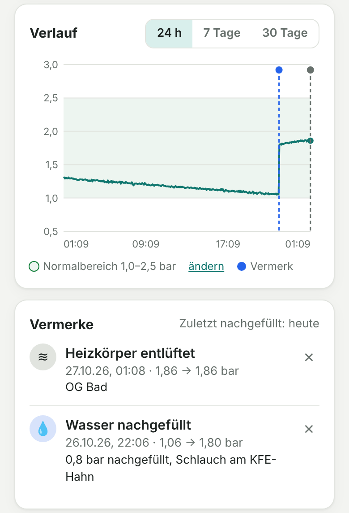
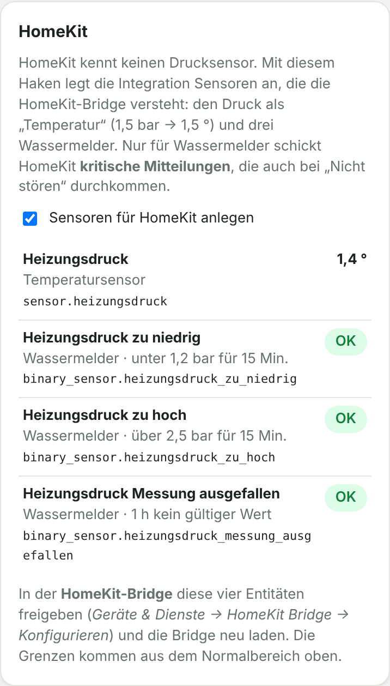

# 3. Home Assistant

Die Integration **„Manometer-Leser“** erledigt alles in Home Assistant: Sie holt die Bilder von der ESP32-CAM, schaltet die LED, erkennt den Zeiger, stellt die Sensoren bereit und bringt die Oberfläche zum Kalibrieren als Eintrag **„Manometer“** in der Seitenleiste mit.

## Voraussetzungen

- Home Assistant **2025.1** oder neuer, mit [HACS](https://hacs.xyz)
- Die ESP32-CAM ist in Home Assistant eingebunden (ESPHome-Integration) → [01-esp32-cam.md](01-esp32-cam.md). Du solltest beim Gerät „Manometer Cam“ eine **Kamera** und ein **Licht „Beleuchtung“** sehen.

## Installieren

**Über HACS:**

[](https://my.home-assistant.io/redirect/hacs_repository/?owner=dieseltoby124&repository=manometer-cam&category=integration)

oder HACS → **⋮ → Benutzerdefinierte Repositories** → `https://github.com/dieseltoby124/manometer-cam`, Typ **Integration** → „Manometer-Leser“ **herunterladen** → Home Assistant **neu starten**.

**Von Hand:** Den Ordner `custom_components/manometer_leser` nach `/config/custom_components/` kopieren und neu starten.

## Einrichten

1. *Einstellungen → Geräte & Dienste → Integration hinzufügen → „Manometer-Leser“*
2. **Kamera** auswählen (z. B. `camera.manometer_cam_manometer`) und **LED** (z. B. `light.manometer_cam_beleuchtung`). Beides ist meist schon vorausgewählt.
3. In der Seitenleiste **„Manometer“** öffnen → **Kalibrieren**:
   1. **Foto aufnehmen.** Mit **Live-Vorschau** die Kamera ausrichten, bei Bedarf mit **↺ / ↻** drehen.
   2. **Mitte der Zeigerachse** antippen. Gedrückt halten zeigt eine Lupe.
   3. Mindestens zwei **Skalenstriche** antippen, z. B. 0 und 4 bar, und den Wert wählen. Ein dritter macht es genauer.
   4. **Zeigerfarbe** wählen: Schwarz, **Weiß/hell** (für dunkle Zifferblätter) oder Rot. Dann **Testen**: Die grüne Linie muss auf dem Zeiger liegen. Passt eine andere Farbe besser, schlägt die Seite sie vor. Dann **Speichern**.
   5. Schritt 5 zeigt **„Fertig – alles eingerichtet“**.


Kamera oder LED später ändern: *Geräte & Dienste → Manometer-Leser → Konfigurieren*.

### Einstellungen in der Seitenleiste
- **Messen alle … Minuten** (Standard 5), **LED-Helligkeit**, „LED nur während Messung und Vorschau“
- **Normalbereich**: grüner Bereich im Verlauf und Grenze für den Problem-Sensor
- **MQTT** (optional), siehe unten

Gespeichert wird alles unter `/config/manometer_leser/` und ist damit in den Home-Assistant-Backups enthalten.

## Entitäten (Gerät „Heizung Manometer“)

| Entität | Beispiel-ID |
|---|---|
| Anlagendruck (bar) | `sensor.heizung_manometer_anlagendruck` |
| Druck außerhalb Normalbereich (Problem) | `binary_sensor.heizung_manometer_druck_ausserhalb_normalbereich` |
| Jetzt messen | `button.heizung_manometer_jetzt_messen` |
| Wasser nachgefüllt (Knopf, trägt einen Vermerk ein) | `button.heizung_manometer_wasser_nachgefullt` |
| Zuletzt Wasser nachgefüllt (Zeitpunkt, Druck vorher/nachher) | `sensor.heizung_manometer_zuletzt_wasser_nachgefullt` |
| Letzter Vermerk | `sensor.heizung_manometer_letzter_vermerk` |
| Letztes Bild (mit erkanntem Zeiger) | `camera.heizung_manometer_letztes_bild` |
| Erkennungsgüte, Letzte Messung, Letzter Fehler, Messung gestört | Diagnose |

Die IDs können bei dir leicht abweichen, sie stehen beim Gerät. Der **Anlagendruck** wird „nicht verfügbar“, wenn länger als 3 Messintervalle kein gültiger Wert kam.

## Vermerke

Hast du Wasser nachgefüllt, Druck abgelassen oder die Heizkörper entlüftet, halte es fest: In der Seitenleiste *Manometer → Übersicht* auf **+ Vermerk**, Art wählen, bei Bedarf Zeitpunkt anpassen und eine Notiz eintragen.

- Der Vermerk erscheint als **gestrichelte Linie im Verlauf**. Darüberfahren zeigt die Notiz.
- In der Liste steht der **Druck vorher → nachher**, aus den Messungen direkt davor und danach.
- Ist der Zeitpunkt „jetzt“, wird gleich nachgemessen. Wenn du erst später einträgst, stell den Zeitpunkt auf das Nachfüllen zurück, sonst stimmt „vorher“ nicht.
- Vermerke bleiben dauerhaft, auch wenn der Verlauf nach 30 Tagen gelöscht wird. Mit × entfernst du einen Vermerk.



**Aus Home Assistant heraus:**
- Knopf **„Wasser nachgefüllt“** beim Gerät, z. B. auf dem Dashboard. Über die HomeKit-Bridge freigegeben, erscheint er in der Home-App als Schalter.
- Aktion `manometer_leser.add_note` für Automationen und Skripte:
  ```yaml
  action: manometer_leser.add_note
  data:
    kind: nachgefuellt        # abgelassen, entlueftet, wartung, sonstiges
    note: "0,5 l nachgefüllt"
  ```
- Jeder Vermerk erscheint im **Logbuch** und löst das Ereignis `manometer_leser_vermerk` aus.

**Wie oft wird nachgefüllt?** Mit dem Sensor „Zuletzt Wasser nachgefüllt“ lässt sich z. B. melden, wenn der Druck schon wenige Wochen nach dem letzten Nachfüllen wieder unter der Untergrenze liegt. Häufiges Nachfüllen deutet auf ein Leck oder ein defektes Ausdehnungsgefäß hin.

## Benachrichtigungen

```yaml
automation:
  - alias: "Heizungsdruck außerhalb Normalbereich"
    trigger:
      - platform: state
        entity_id: binary_sensor.heizung_manometer_druck_ausserhalb_normalbereich
        to: "on"
        for: "00:15:00"
    action:
      - service: notify.notify            # durch deinen Benachrichtigungsdienst ersetzen
        data:
          title: "Heizung"
          message: "Anlagendruck {{ states('sensor.heizung_manometer_anlagendruck') }} bar – außerhalb des Normalbereichs."

  - alias: "Manometer liefert keine Werte"
    trigger:
      - platform: state
        entity_id: sensor.heizung_manometer_anlagendruck
        to: "unavailable"
        for: "01:00:00"
    action:
      - service: notify.notify
        data:
          message: "Manometer liefert seit 1 h keine Werte – Kamera und Seitenleiste „Manometer“ prüfen."
```

### Schleichenden Druckverlust erkennen

*Helfer → Statistik*, Merkmal „Änderung“, Zeitraum 7 Tage, oder per YAML:

```yaml
sensor:
  - platform: statistics
    name: "Anlagendruck Änderung 7 Tage"
    entity_id: sensor.heizung_manometer_anlagendruck
    state_characteristic: change
    max_age:
      days: 7
    sampling_size: 5000
```

Fällt der Wert z. B. unter −0,3 bar, verliert die Anlage Wasser. Warmes Wasser hat mehr Druck als kaltes (meist 0,2–0,5 bar Unterschied), deshalb Werte zur gleichen Tageszeit vergleichen.

## MQTT für ioBroker & Co. (optional)

Voraussetzung: Die **MQTT-Integration** ist in Home Assistant eingerichtet, z. B. mit dem Mosquitto-Add-on oder einem eigenen Broker. Dann in der Seitenleiste *Manometer → Einstellungen → MQTT* **„Werte zusätzlich per MQTT senden“** anhaken. Topics: [05-mqtt.md](05-mqtt.md), ioBroker: [04-iobroker.md](04-iobroker.md).

## HomeKit (über die HomeKit-Bridge)

HomeKit kennt keinen Drucksensor und keine Einheit bar. Die Integration legt deshalb auf Wunsch eigene Sensoren für HomeKit an:

1. Seitenleiste *Manometer → Einstellungen → HomeKit* → **„Sensoren für HomeKit anlegen“** anhaken → speichern.
2. *Geräte & Dienste → HomeKit Bridge → Konfigurieren* → diese vier Entitäten freigeben → Bridge **neu laden**.
3. In der Home-App einen eigenen Raum wie „Heizungsraum“ anlegen und die Sensoren dorthin verschieben, sonst fließt die „Temperatur“ in den Raum-Durchschnitt ein.

| Entität | In der Home-App | Löst aus |
|---|---|---|
| `sensor.heizungsdruck` | Temperatursensor, **23 ° = 2,3 bar** | – |
| `binary_sensor.heizungsdruck_zu_niedrig` | Wassermelder | 15 Min. unter der Untergrenze des Normalbereichs |
| `binary_sensor.heizungsdruck_zu_hoch` | Wassermelder | 15 Min. über der Obergrenze |
| `binary_sensor.heizungsdruck_messung_ausgefallen` | Wassermelder | 1 h kein gültiger Messwert |

Die Entitäts-IDs können bei dir anders aussehen (z. B. mit Bereich davor), das Panel zeigt die echten.

**Warum × 10?** Die Home-App zeigt Temperaturen nur in halben Grad an und macht aus 2,3 sonst 2,5. Deshalb wird der Druck standardmäßig mal 10 gesendet: 23 ° bedeutet 2,3 bar, genau auf 0,1 bar. Wer lieber 2,3 ° sehen will, nimmt den Haken „Druck × 10 senden“ heraus.

Wassermelder deshalb, weil HomeKit nur für sie **kritische Mitteilungen** schickt, die auch bei „Nicht stören“ durchkommen. Die Grenzen kommen aus dem **Normalbereich** in den Einstellungen.



**Tipps zur HomeKit-Bridge**
- Eine Bridge schafft höchstens **150 Geräte**. Wer ganze Domains wie `sensor` freigibt, ist schnell darüber, alles Weitere fehlt dann ohne Meldung. Besser eine eigene Bridge nur für diese vier Entitäten.
- Hattest du vorher selbst Template-Helfer mit denselben Namen angelegt, diese löschen, sonst heißen die neuen Entitäten `…_2`.
- Haken wieder entfernen löscht die vier Entitäten.

## Fehlersuche

| Problem | Lösung |
|---|---|
| „Kamera nicht erreichbar“ | Ist die ESP32-CAM in Home Assistant online? Kamerabild beim Gerät „Manometer Cam“ prüfen |
| „Zeiger nicht sicher erkannt“ | Zeigerfarbe richtig? Spiegelung → LED-Helligkeit senken. Ggf. neu kalibrieren |
| „Manometer im Bild nicht wiedergefunden“ | Kamera stark verrutscht/verdeckt → ausrichten, neu kalibrieren |
| „LED nicht schaltbar“ | Licht-Entität unter *Konfigurieren* prüfen |
| Panel „Manometer“ fehlt | Home Assistant nach der Installation neu starten; die Seitenleiste ist nur für Administratoren sichtbar |
| Umstieg von Version 1 (externer Server) | Alte Integration entfernen, neu hinzufügen, einmal neu kalibrieren |
