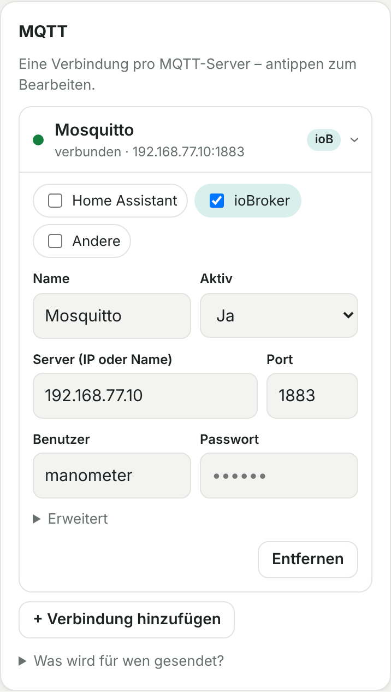

# 5. MQTT

**Mit Home Assistant:** In der Seitenleiste *Manometer → Einstellungen → MQTT* „Werte zusätzlich per MQTT senden“ anhaken. Gesendet wird über die MQTT-Integration von Home Assistant (Topics unten, ohne Discovery – in Home Assistant gibt es die Werte ja schon als Entitäten).

**Eigenständiger Server (ohne Home Assistant):** Unter *Einstellungen → MQTT* legst du eine oder mehrere **Verbindungen** an, eine pro MQTT-Broker. Bei jeder wählst du, **für wen** gesendet wird, auch mehreres gleichzeitig:

| Ziel | Was gesendet wird |
|---|---|
| **Home Assistant** | Discovery (Gerät erscheint automatisch) + Werte als JSON |
| **ioBroker** | Einzelwerte `druck`, `guete`, `zeitstempel` |
| **Andere** (Node-RED, openHAB, FHEM …) | JSON + Einzelwerte, ohne Discovery |

Immer dabei: `status` (online/offline) und `error`.



**Ein Broker für alles?** Dann reicht eine Verbindung mit mehreren Häkchen.

## Topics

Präfix (Standard `heizung/manometer`, unter „Erweitert“ änderbar):

| Topic | Inhalt | Ziel |
|---|---|---|
| `…/druck` | Druck in bar, z. B. `1.52` | ioBroker, Andere |
| `…/guete` | Erkennungsgüte 0–100 | ioBroker, Andere |
| `…/zeitstempel` | `2026-10-16T09:00:12+0200` | ioBroker, Andere |
| `…/state` | `{"pressure": 1.523, "confidence": 100}` | Home Assistant, Andere |
| `…/error` | `ok` oder Fehlermeldung | alle |
| `…/status` | `online` / `offline` (Last Will) | alle |
| `homeassistant/sensor/manometer/*/config` | Discovery | Home Assistant |

Alle Nachrichten werden mit **retain** gesendet. Wer sich neu verbindet, bekommt also sofort den letzten Wert. Gesendet wird nach jeder Messung (Standard alle 5 Minuten). Bilder werden nie über MQTT gesendet.

Ein **zweiter Manometer-Leser** (z. B. an einer anderen Anlage) braucht einen eigenen Präfix, sonst überschreiben sich die Werte.

## Zentraler Broker als Proxmox-Container (optional)

Ein eigener Mosquitto-Container ist unabhängig von Home Assistant und ioBroker und kann allen dienen (auch Zigbee2MQTT).

```bash
# Debian-/Ubuntu-Container, feste IP
apt update && apt install -y mosquitto mosquitto-clients
cat > /etc/mosquitto/conf.d/default.conf <<'EOF'
listener 1883
allow_anonymous false
password_file /etc/mosquitto/passwd
persistence true
EOF
mosquitto_passwd -c /etc/mosquitto/passwd homeassistant
mosquitto_passwd /etc/mosquitto/passwd iobroker
mosquitto_passwd /etc/mosquitto/passwd manometer
mosquitto_passwd /etc/mosquitto/passwd zigbee2mqtt
chown root:mosquitto /etc/mosquitto/passwd && chmod 640 /etc/mosquitto/passwd
systemctl enable --now mosquitto && systemctl restart mosquitto
```

Test: `mosquitto_sub -h localhost -u homeassistant -P <passwort> -t 'heizung/#' -v`

**Zigbee2MQTT** auf den zentralen Broker umstellen und für ioBroker zusätzlich Einzelwerte senden lassen:

```yaml
mqtt:
  server: mqtt://<Broker-IP>:1883
  user: zigbee2mqtt
  password: <passwort>
advanced:
  output: attribute_and_json
```
